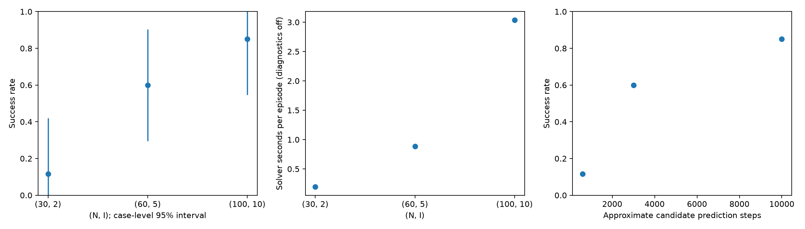

# Apple Silicon PushT 冻结模型规划实验

实验日期：2026-11-18。代码基准提交：`3a0fd7b58aeba09831840207f11ae6ad2569ef12`。本实验使用官方预训练 LeWM，不进行模型训练；目标是观察 CEM 搜索预算对 PushT 闭环成功率与求解时间的影响。

## 实验做了什么

PushT 要求控制圆点推动 T 形物体，使其到达目标状态。实验从 `pusht_expert_train` 中选取 20 个不同 episode，各取一个起点及该轨迹 25 步之后的目标；每回合最多执行 50 个环境动作。三个条件使用相同案例、相同模型和规划种子 42、43、44，每个条件执行 60 回合，共 180 回合。20 个案例是统计上的独立单位；三个规划种子不是独立案例。

每次规划通过 CEM 搜索动作序列。N 是每轮候选数，I 是迭代次数；三个条件均使用 top-k=10、预测视野 5、每动作块 5 步、执行 5 块后重新规划。模型使用 MPS、float32，每次前向最多处理 16 个候选。条件同时改变 N 和 I，因此不能分别识别两者的作用。

## 结果

| N / I | 种子 42 成功数 | 种子 43 成功数 | 种子 44 成功数 | 平均成功率 | 每回合平均求解时间 |
| --- | ---: | ---: | ---: | ---: | ---: |
| 30 / 2 | 3/20 | 1/20 | 3/20 | 11.7% | 0.194 秒 |
| 60 / 5 | 14/20 | 12/20 | 10/20 | 60.0% | 0.885 秒 |
| 100 / 10 | 16/20 | 19/20 | 16/20 | 85.0% | 3.038 秒 |

在这组案例中，较高的搜索预算对应更高的成功率和更长的求解时间。这是描述性比较，并非显著性检验。按案例聚合的保守 Hoeffding 95% 区间分别为 0–42.0%、29.6–90.4% 和 54.6–100%；完整数值见 [汇总 JSON](mac_budget_figures/budget_summary.json)。求解时间包括采样、模型评分、设备传输、精英更新和结果转回 CPU；不包括全部数据准备、环境执行和程序启动时间。

[预算对比动画](mac_environment/pusht_budget_comparison.gif)使用种子 42 的同一案例 `1a6f0e3926ec`，从已记录的动作重新播放：低预算失败，高预算成功；右侧是目标画面。重放结果与原记录的成功标记一致。这是选取的示例，不代表总体。

## 与论文的关系

[LeWorldModel 论文 v1](https://arxiv.org/html/2603.19312v1) 表 5 报告 PushT 成功率 96.0% ± 2.83%，对同一组 50 条轨迹评估三个训练种子。论文 PushT 规划使用 N=300、I=30、top-k=30。我们最高预算为 N=100、I=10、top-k=10，使用一个预训练权重和三个规划种子，案例也不同。因此 85% 与 96% 不能视为同条件对比，本实验不能称为论文数值或训练结果的成功复现。案例来自训练数据集，不能据此声称未见任务泛化。

## 验收与产物

安装脚本的依赖检查和 MPS doctor 通过；六组 README 测试通过。真实官方权重通过 MPS 合成输入前向预检；两案例正式/诊断配对的执行动作逐位一致，回放审计完成并生成图像。九个正式目录的 `STATUS.json` 均为 complete，每个目录含逐案例和逐规划记录、执行动作、运行元数据及状态。`mac_cases.json` 保存案例清单；`mac_budget_figures` 是汇总；`mac_smoke_*` 是验收和审计记录；`mac_environment` 包含实际依赖版本、预检日志、运行配置和动画。`activate.sh` 与配置中绝对路径是原机器记录，其他机器需调整。

数据集 SHA-256：`b6ebd9ac94bbe9e383f6e7a9cd92d74e9aa665ea57b758ed3717b0ee7df8d4fb`；模型权重 SHA-256：`48938400ae3464c9680731287f583a9cb516f55a8ec64ea13a91be47fb15b607`。原始数据、模型与 Python 环境在本机，不包含在这些运行记录中。

要进一步对照论文，需对齐 50 个评估案例、官方评估流程与 N=300/I=30/top-k=30，并核查实现差异。要复现论文的训练种子方差，还需独立训练多个模型。
